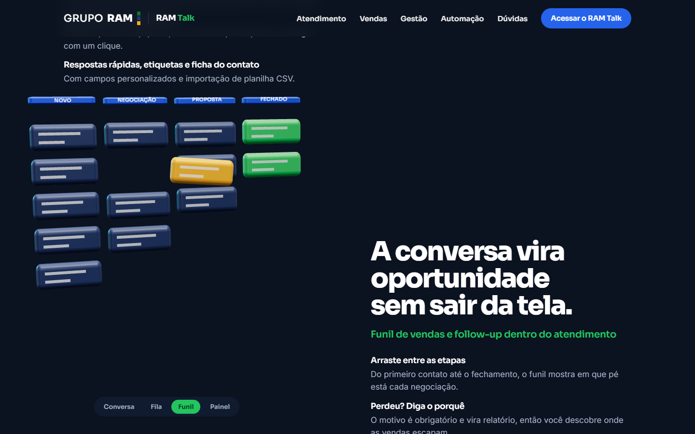
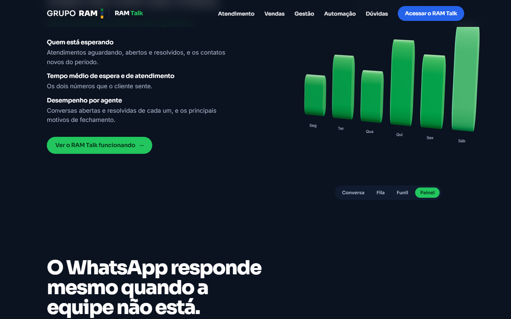
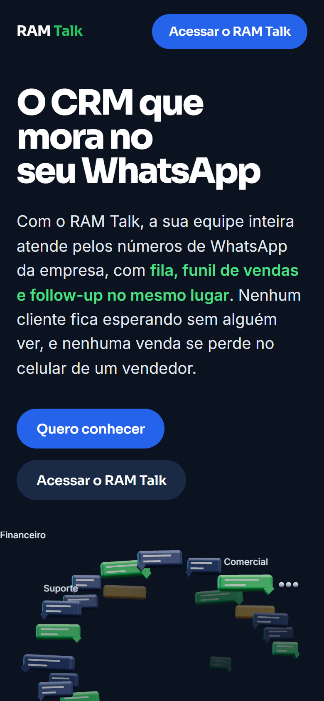

# RAM Talk, página de apresentação

A landing do RAM Talk, o CRM do Grupo RAM que funciona no WhatsApp. A equipe inteira atende pelos números da empresa, com fila, funil de vendas e follow-up no mesmo lugar.

**Veja funcionando:** https://ramtalk.dev.gruporam.com.br

## A ideia

A página conta a história do produto em uma cena só: do caos à ordem. No topo, uma nuvem de conversas soltas, em profundidade e com névoa, envolve o título. São conversas de vários números da empresa (Comercial, Suporte, Financeiro), alguém digitando, tudo espalhado, como é o WhatsApp de uma empresa sem sistema.

Ao rolar, as mesmas peças se organizam: viram a fila de três atendentes, os cartões do funil e as barras do painel. Cada forma se monta do lado oposto ao texto, que alterna entre esquerda e direita, e uma trilha embaixo (Conversa, Fila, Funil, Painel) mostra onde se está.

  
  

## Como foi feito

- HTML, CSS e um módulo JavaScript, sem framework, encapsulados para entrar no app sem conflito: classes e ids com prefixo `rt-`, regras presas a um bloco só e fontes com nome próprio. Foi testada colada numa página com estilos globais agressivos e ficou igual à página sozinha.
- Uma cena em Three.js com 24 peças instanciadas que trocam de forma conforme a rolagem, carregada depois da primeira pintura. Movimento em GSAP e Lenis.
- No celular, cada bloco tem um espaço acima do título, e a cena passa de um para o outro, se transformando na forma do bloco.
- Com movimento reduzido, a nuvem aparece parada. Sem WebGL, a página fica inteira, sem a cena.
- Recursos citados são os que existem no app. Nomes e números das ilustrações são fictícios.

---

O código-fonte é privado. Este repositório é a apresentação do projeto, feito para o Grupo RAM, onde trabalho.

**Lucas de Oliveira Andrade**, [lucas-andrade.dev](https://lucas-andrade.dev)
